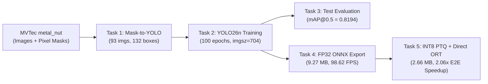

# Industrial Defect Detection on MVTec AD (`metal_nut`) — YOLO26n, ONNX & INT8 Optimization

End-to-end computer vision pipeline for automated surface and structural defect detection on the **MVTec Anomaly Detection (`metal_nut`)** dataset. This repository covers pixel-mask-to-YOLO bounding box conversion, training an ultra-lightweight **YOLO26n** detector, held-out test evaluation with failure-mode analysis, **FP32 ONNX** export with CPU benchmarking, and **Static INT8 Post-Training Quantization (PTQ)** coupled with a low-latency **Direct OpenCV DNN + ONNX Runtime** inference pipeline.

> 📄 **For complete experimental tables, training curves, confusion matrices, failure case visualizations, and CPU latency benchmarks, see [`RESULTS.md`](RESULTS.md).**

---

## 📌 Key Highlights

| Stage | Artifact / Deliverable | Key Result |
| :--- | :--- | :--- |
| **Task 1 — Mask-to-BBox Annotation** | [`outputs/task1_labels/labels/`](outputs/task1_labels/labels/) | **93** defective images converted to **132** normalized YOLO bounding boxes across 4 defect types (`bent`, `color`, `flip`, `scratch`) |
| **Task 2 — YOLO26n Training** | [`runs/detect/outputs/task2_training/yolo26n_baseline-2/`](runs/detect/outputs/task2_training/yolo26n_baseline-2/) | **0.997 Precision**, **1.000 Recall**, **0.995 mAP@0.5**, **0.870 mAP@0.5:0.95** on validation (`imgsz=704`, 100 epochs in 5.6 min on RTX 3060) |
| **Task 3 — Held-Out Test Evaluation** | [`outputs/task3_evaluation/failure_cases/`](outputs/task3_evaluation/failure_cases/) | **0.9907 Precision**, **0.7273 Recall**, **0.8194 mAP@0.5**, **0.6827 mAP@0.5:0.95** on 36 test images (0 false positives on all 22 normal nuts) |
| **Task 4 — FP32 ONNX Export & CPU Benchmark** | [`outputs/task4_onnx/best_fp32.onnx`](outputs/task4_onnx/best_fp32.onnx) | **9.27 MB** model; **10.140 ms** avg inference (**98.62 FPS**), **8.311 ms** median on Intel Core i7-12650H (`256×256`) |
| **Task 5 — INT8 Quantization & Direct Pipeline** | [`outputs/task5_int8/best_int8.onnx`](outputs/task5_int8/best_int8.onnx) | **2.66 MB** (**3.49× compression / -71.3% size**), **0.7820 mAP@0.5** (+2.63% over FP32 at `256×256`), and **23.279 ms end-to-end latency** (**2.06× speedup**, **42.96 FPS**) via Direct OpenCV + ONNX Runtime |

---

## 📂 Repository Structure

```text
.
├── tasks.ipynb                                  # Complete end-to-end Jupyter Notebook (Tasks 1–5)
├── README.md                                    # Reproducibility guide & architecture documentation
├── RESULTS.md                                   # Detailed experimental results, plots & failure analysis
├── .gitignore                                   # Excludes raw metal_nut/ dataset; retains models, runs & outputs
├── yolo26n.pt                                   # Pretrained YOLO26n base weights (5.3 MB)
├── weights/
│   └── yolo26n.pt                               # Backup copy of pretrained YOLO26n base weights
├── outputs/
│   ├── task1_labels/
│   │   └── labels/{bent,color,flip,scratch}/    # 93 generated YOLO .txt files (132 total defect boxes)
│   ├── task2_dataset/
│   │   ├── data.yaml                            # Ultralytics dataset configuration
│   │   ├── images/{train,val,test}/             # Split dataset images (incl. 36 held-out test images)
│   │   └── labels/{train,val,test}/             # Corresponding YOLO labels (empty .txt for normal/good images)
│   ├── task3_evaluation/
│   │   └── failure_cases/                       # 5 high-resolution failure analysis plots (failure_case_1..5.png)
│   ├── task4_onnx/
│   │   ├── best_fp32.onnx                       # Exported FP32 ONNX model (9.27 MB, 256×256)
│   │   └── cpu_benchmark.csv                    # Per-image CPU inference & end-to-end latency log (36 images)
│   └── task5_int8/
│       ├── best_int8.onnx                       # Calibrated Static INT8 ONNX model (2.66 MB, 256×256)
│       ├── fp32_vs_int8_accuracy.csv            # FP32 vs. INT8 precision, recall, mAP@0.5, mAP@0.5:0.95
│       └── fp32_vs_int8_benchmark.csv           # Side-by-side size, latency, P95, and FPS comparison
└── runs/
    └── detect/
        ├── outputs/
        │   ├── task2_training/
        │   │   ├── yolo26n_baseline/            # Initial exploratory run (17 epochs)
        │   │   └── yolo26n_baseline-2/          # Full 100-epoch baseline training run, plots & weights/best.pt
        │   ├── task3_evaluation/
        │   │   └── corrected_test/              # Final 36-image held-out test evaluation curves & confusion matrix
        │   └── task5_int8/
        │       ├── fp32_evaluation{-2,-3}/      # FP32 ONNX evaluation plots & confusion matrices
        │       └── int8_evaluation{-2,-3}/      # INT8 ONNX evaluation plots & confusion matrices
        └── val{-2}/                             # Intermediate validation/test evaluation logs
```

---

## 🛠️ Environment & Dependencies

### Hardware Used for Experiments
* **GPU (Training & Task 3 Evaluation)**: NVIDIA GeForce RTX 3060 Laptop GPU (5,806 MiB VRAM, CUDA 13.0)
* **CPU (Task 4 & Task 5 ONNX Benchmarks)**: 12th Gen Intel® Core™ i7-12650H
* **OS**: Linux (`Python 3.10.21`)

### Software Installation
Create a virtual environment (Python 3.10+ recommended) and install the required packages:

```bash
python3 -m venv .venv
source .venv/bin/activate
pip install --upgrade pip

# Core dependencies matching experimental environment
pip install torch torchvision --index-url https://download.pytorch.org/whl/cu124
pip install ultralytics>=8.4.178 opencv-python numpy pandas matplotlib Pillow scikit-learn onnx>=1.23.2 onnxruntime>=1.23.2 onnxslim>=0.1.99 jupyter
```

---

## 📥 Dataset Setup

The raw **MVTec AD `metal_nut`** dataset (`metal_nut/` and `metal_nut.zip`) is excluded via [`.gitignore`](.gitignore) to keep the repository lightweight and compliant with dataset redistribution terms.

> **Note:** The processed YOLO labels (`outputs/task1_labels/`), split structure (`outputs/task2_dataset/`), trained checkpoints (`runs/`), and exported ONNX models (`outputs/task4_onnx/`, `outputs/task5_int8/`) are **already included** in this repository. You only need the raw `metal_nut/` folder if you wish to re-run **Task 1** and **Task 2 dataset generation** from scratch.

To set up the raw dataset:
1. Download the **`metal_nut`** category archive from the official [MVTec Anomaly Detection Dataset](https://www.mvtec.com/company/research/datasets/mvtec-ad).
2. Extract it into the repository root so the structure matches:
   ```text
   metal_nut/
   ├── ground_truth/
   │   ├── bent/        # 000_mask.png .. 024_mask.png (25 binary masks)
   │   ├── color/       # 000_mask.png .. 021_mask.png (22 binary masks)
   │   ├── flip/        # 000_mask.png .. 022_mask.png (23 binary masks)
   │   └── scratch/     # 000_mask.png .. 022_mask.png (23 binary masks)
   ├── test/
   │   ├── bent/        # 25 defective images (700×700 PNG)
   │   ├── color/       # 22 defective images (700×700 PNG)
   │   ├── flip/        # 23 defective images (700×700 PNG)
   │   ├── scratch/     # 23 defective images (700×700 PNG)
   │   └── good/        # 22 normal test images (700×700 PNG)
   └── train/
       └── good/        # 220 normal training images (700×700 PNG)
   ```

---

## 🚀 Step-by-Step Reproduction Guide

All tasks are implemented sequentially in [`tasks.ipynb`](tasks.ipynb). You can either execute the notebook top-to-bottom (`jupyter notebook tasks.ipynb`) or run individual stages as documented below.



---

### Task 1: Mask-to-YOLO Bounding Box Conversion (Cells 0–6)

Converts pixel-level ground-truth masks (`metal_nut/ground_truth/<category>/<id>_mask.png`) into single-class (`0: defect`) normalized YOLO annotations (`class_id x_center y_center width height`):
* **Connected-Component Extraction (`bent`, `color`, `scratch`)**: Uses `cv2.connectedComponentsWithStats(..., connectivity=8)` so multiple distinct surface defects on the same part receive separate bounding boxes, sorted deterministically by `(y, x)`.
* **Whole-Mask Extraction (`flip`)**: Because a flipped metal nut is a global orientation anomaly whose mask spans the ring body around the central hole, connected components would artificially fragment a single flipped nut. `extract_whole_mask_bbox()` generates a single encompassing box per `flip` mask.
* **Validation**: Verifies `700 × 700` image-mask alignment, non-empty masks, and normalized coordinates $\in [0, 1]$.
* **Output**: Writes 93 `.txt` files (132 total bounding boxes) to [`outputs/task1_labels/labels/`](outputs/task1_labels/labels/).

---

### Task 2: Stratified Dataset Split & YOLO26n Training (Cells 7–15)

1. **Dataset Construction (`outputs/task2_dataset/`)**:
   * **Defective images (93 total)**: Two-stage stratified split by defect category (`bent`, `color`, `flip`, `scratch`) into **70% Train (65)** / **15% Val (14)** / **15% Test (14)**.
   * **Normal (`good`) images (242 total)**: `train/good` (220) is split **80% Train (176)** / **20% Val (44)**; `test/good` (22) is placed entirely into **Test (22)**. Normal images receive empty `.txt` label files so the detector learns to suppress false positives on defect-free nuts.
   * **Note on `outputs/task2_dataset/data.yaml`**: The `path:` field in [`outputs/task2_dataset/data.yaml`](outputs/task2_dataset/data.yaml) is generated dynamically using `DETECTION_ROOT.resolve()` in Cell 14. When reproducing on a new machine, re-run Cell 14 (or set `path: .` relative to `outputs/task2_dataset`) before training.
   * **Reproducibility Note on Split Counts**: In `tasks.ipynb` Cells 10–11, `train_test_split` was called without passing `random_state=SEED`. To guarantee an identical split on a fresh directory, pass `random_state=SEED` (`SEED = 42`) to the three `train_test_split` calls and clear `outputs/task2_dataset/` prior to copying. (In the saved workspace, running the copy step across two notebook sessions without clearing `train`/`val` resulted in 296 train and 103 val files, while `test` was cleaned to the exact 36 held-out images [14 defective + 22 normal]).

2. **Model Training (Cell 15)**:
   * Trains [`yolo26n.pt`](yolo26n.pt) for 100 epochs at `imgsz=700` (auto-aligned to stride-32 multiple `704`), `seed=42`, `patience=20`, `amp=True`, `optimizer=auto` (`AdamW`, `lr=0.002`, `momentum=0.9`), and `close_mosaic=10`.
   * Equivalent standalone command:
     ```bash
     yolo detect train \
       model=yolo26n.pt \
       data=outputs/task2_dataset/data.yaml \
       epochs=100 imgsz=700 batch=16 device=0 patience=20 seed=42 \
       project=outputs/task2_training name=yolo26n_baseline-2 plots=True
     ```
   * **Best Checkpoint**: Saved to [`runs/detect/outputs/task2_training/yolo26n_baseline-2/weights/best.pt`](runs/detect/outputs/task2_training/yolo26n_baseline-2/weights/best.pt) (5.5 MB).

---

### Task 3: Held-Out Test Set Evaluation & Failure Analysis (Cells 16–22)

1. **Test Set Evaluation (Cell 20)**:
   * Evaluates `best.pt` on the 36 held-out test images (14 defective with 22 ground-truth boxes + 22 normal background images):
     ```bash
     yolo detect val \
       model=runs/detect/outputs/task2_training/yolo26n_baseline-2/weights/best.pt \
       data=outputs/task2_dataset/data.yaml \
       split=test imgsz=700 batch=32 conf=0.001 plots=True \
       project=outputs/task3_evaluation name=corrected_test
     ```
2. **Failure Case Extraction & Visualization (Cells 21–22)**:
   * Runs inference at operational thresholds (`imgsz=704`, `conf=0.25`, `iou=0.70`) and matches predictions to ground-truth boxes greedily by confidence at $\text{IoU} \ge 0.50$.
   * Generates color-coded diagnostic visualizations (`cyan` = Matched GT, `yellow` = Missed GT / FN, `lime` = Correct Prediction / TP, `red` = False Positive / FP) saved to [`outputs/task3_evaluation/failure_cases/`](outputs/task3_evaluation/failure_cases/).

---

### Task 4: FP32 ONNX Export & CPU Latency Benchmark (Cells 23–27)

1. **FP32 ONNX Export (Cell 26)**:
   * Exports `best.pt` to a static-shape (`1×3×256×256`), simplified ONNX graph (`opset=18`, `nms=False`, `simplify=True` via `onnxslim`) and verifies structural validity with `onnx.checker.check_model` and `CPUExecutionProvider`:
     ```python
     from ultralytics import YOLO
     import shutil

     model = YOLO("runs/detect/outputs/task2_training/yolo26n_baseline-2/weights/best.pt")
     exported = model.export(format="onnx", imgsz=256, dynamic=False, simplify=True, half=False, device="cpu", nms=False)
     shutil.copy2(exported, "outputs/task4_onnx/best_fp32.onnx")
     ```
2. **CPU Latency Benchmark (Cell 27)**:
   * Runs 5 warm-up iterations followed by 36 timed single-image predictions (`batch=1`, `imgsz=256`, `conf=0.25`, `device="cpu"`) and logs per-image inference and end-to-end times to [`outputs/task4_onnx/cpu_benchmark.csv`](outputs/task4_onnx/cpu_benchmark.csv).

---

### Task 5: Static INT8 Quantization & Direct OpenCV + ONNX Runtime Pipeline (Cells 28–33)

1. **Static INT8 Quantization (Cell 29)**:
   * Exports and calibrates a static INT8 quantized ONNX model using ONNX Runtime calibration over the dataset validation split:
     ```python
     exported_int8 = model.export(
         format="onnx", imgsz=256, quantize=8,
         data="outputs/task2_dataset/data.yaml",
         fraction=1.0, dynamic=False, device="cpu", nms=False
     )
     shutil.copy2(exported_int8, "outputs/task5_int8/best_int8.onnx")
     ```
2. **FP32 vs. INT8 Accuracy & Latency Comparison (Cells 30–31)**:
   * Evaluates both [`outputs/task4_onnx/best_fp32.onnx`](outputs/task4_onnx/best_fp32.onnx) and [`outputs/task5_int8/best_int8.onnx`](outputs/task5_int8/best_int8.onnx) on the 36-image test set (`batch=1`, `device="cpu"`) and writes summary tables to [`outputs/task5_int8/fp32_vs_int8_accuracy.csv`](outputs/task5_int8/fp32_vs_int8_accuracy.csv) and [`outputs/task5_int8/fp32_vs_int8_benchmark.csv`](outputs/task5_int8/fp32_vs_int8_benchmark.csv).
3. **Direct OpenCV DNN + ONNX Runtime Inference Benchmark (Cell 33)**:
   * Eliminates Ultralytics Python wrapper overhead (~34 ms/image) by executing preprocessing via `cv2.dnn.blobFromImage` (`0.372 ms`), direct `ort.InferenceSession.run()` (`10.768 ms`), and vectorized NumPy confidence filtering (`conf >= 0.25`), cutting total end-to-end latency in half from **47.884 ms** to **23.279 ms** (**42.96 FPS**).

---

## 📊 Summary of Results

Full analysis, charts, and per-image breakdowns are available in **[`RESULTS.md`](RESULTS.md)**.

| Model / Pipeline | Precision | Recall | mAP@0.5 | mAP@0.5:0.95 | Size (MB) | Avg Inference (ms) | End-to-End (ms) |
| :--- | :---: | :---: | :---: | :---: | :---: | :---: | :---: |
| **PyTorch `best.pt` (`704×704`, GPU Val)** | 0.9970 | 1.0000 | 0.9950 | 0.8700 | 5.22 | 2.30 (GPU) | — |
| **PyTorch `best.pt` (`704×704`, GPU Test)** | 0.9907 | 0.7273 | 0.8194 | 0.6827 | 5.22 | 4.30 (GPU) | — |
| **ONNX FP32 (`256×256`, CPU Task 4)** | 0.8353 | 0.7727 | 0.7556 | 0.6185 | 9.272 | 10.140 (11.929*) | 47.418 (47.050*) |
| **ONNX INT8 (`256×256`, CPU Ultralytics)** | **0.8835** | 0.7273 | **0.7820** | 0.5646 | **2.658** | 13.247 | 47.884 |
| **ONNX INT8 (`256×256`, CPU Direct OpenCV+ORT)** | **0.8835** | 0.7273 | **0.7820** | 0.5646 | **2.658** | **10.768** | **23.279 (42.96 FPS)** |

*\*Values in parentheses reflect the back-to-back Task 5 comparison run (`fp32_vs_int8_benchmark.csv`).*
